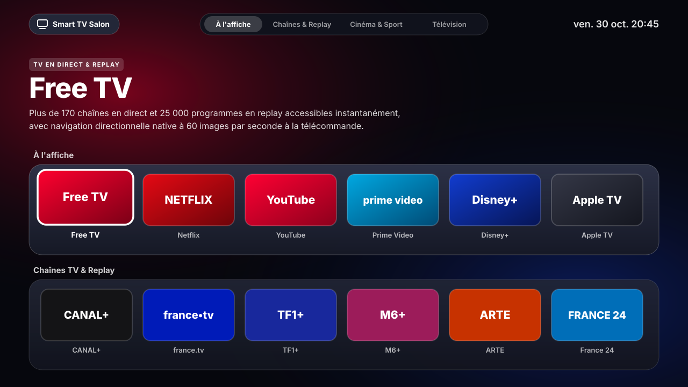

# Smart TV Salon • Interface fluide pour Titan OS



Une interface d'accueil légère, épurée et ultra réactive pensée pour les téléviseurs équipés du système **Titan OS** (notamment les téléviseurs connectés Philips).

Conçu intégralement en **HTML5, CSS3 moderne et JavaScript modulaire**, ce projet apporte une expérience fluide à **60 images par seconde**, pilotable directement avec les **flèches de la télécommande**, sans la lourdeur des bandeaux publicitaires d'origine ni le désagrément d'un curseur de souris virtuel.

***

## Points forts du projet

* **Navigation télécommande native** : Déplacement immédiat de vignette en vignette avec les flèches directionnelles et validation avec la touche `OK`, sans curseur de souris.
* **Architecture modulaire et propre** : Séparation claire des responsabilités entre la structure HTML, les feuilles de style CSS et les modules JavaScript spécialisés.
* **Rendu fluide à 60 images par seconde** : Accélération matérielle via `transform: translate3d()` et transitions fluides spécialement optimisées pour les processeurs de téléviseurs.
* **Harmonisation visuelle type Apple tvOS** : Effets de verre dépoli, courbes concentriques équilibrées et mise en valeur dynamique des affiches avec grand bandeau de présentation.
* **Défilement vertical épuré** : Disparition progressive et automatique des rangées supérieures lors du défilement vers le bas pour garder un affichage net et sans encombrement.
* **Catalogue complet sur 4 rangées** : Accès direct aux plateformes majeures de vidéo, au direct télévisé et replay, à la musique, au sport ainsi qu'aux fonctions système du téléviseur (Sources, Réglages, Guide des programmes).
* **Raccourci personnalisé stocké localement** : Possibilité d'ajouter son propre portail web (Jellyfin, Home Assistant ou serveur multimédia personnel). Les données restent exclusivement sur l'appareil de l'utilisateur.
* **Respect absolu de la vie privée** : Aucun pistage, aucune télémétrie, aucune dépendance externe, politique de sécurité stricte.

***

## Organisation du code source

```text
bdsalocin.github.io/
│
├── index.html          Structure HTML5 épurée et sémantique
├── preview.svg         Aperçu graphique haute définition du projet
│
├── css/
│   └── styles.css      Styles visuels complets (verre dépoli, typographie, grille, modale)
│
├── js/
│   ├── apps.js         Catalogue des applications, catégories et raccourcis
│   ├── launcher.js     Moteur de déclenchement d'applications et intégrations TV
│   ├── navigation.js   Gestion des événements de la télécommande et touches directionnelles
│   ├── ui.js           Moteur d'affichage dynamique, défilement et mise en valeur
│   └── main.js         Point d'entrée principal et démarrage au chargement
│
├── msx/
│   ├── start.json      Point d'entrée pour le démarrage sur Media Station X
│   └── content.json    Lancement direct de l'interface en plein écran
│
├── _headers            Directives de sécurité et en têtes HTTP
├── LICENSE             Licence libre et open source MIT
└── README.md           Documentation complète du projet
```

***

## Gestion des branches Git

Le dépôt est structuré selon les standards professionnels :

* **`main`** : Branche de production officielle, stable et directement diffusée en ligne via GitHub Pages.
* **`develop`** : Branche active de travail pour développer, tester et peaufiner les nouvelles idées avant publication.

***

## Utilisation et déploiement

### 1. Sur votre ordinateur (test et prévisualisation)
Ouvrez simplement le fichier `index.html` dans un navigateur moderne. Vous pouvez naviguer dans l'ensemble des rangées à l'aide des **flèches de votre clavier** et ouvrir un service avec la touche **Entrée**.

### 2. Sur un téléviseur Titan OS (sans modifier le système)
L'interface s'exécute en plein écran avec votre télécommande d'origine grâce à l'application officielle **Media Station X**, disponible gratuitement dans le magasin d'applications du téléviseur :

1. Déployez le projet sur GitHub Pages (ou utilisez l'adresse déjà hébergée).
2. Lancez **Media Station X** sur votre téléviseur Philips Titan OS.
3. Rendez vous dans le menu `Settings` puis `Start Parameter` puis `Setup`.
4. Saisissez l'adresse de votre portail (par exemple `bdsalocin.github.io`), puis validez.
5. L'interface se charge immédiatement en plein écran et répond directement à votre télécommande.

*Cette installation ne modifie aucun fichier du système d'exploitation du téléviseur. Elle peut être arrêtée ou réinitialisée à tout instant depuis les paramètres de l'application Media Station X.*

***

## Mentions légales

Projet indépendant réalisé à titre d'expérimentation d'interface utilisateur et de démonstration technique.
Ce projet n'est ni affilié ni approuvé par Titan OS S.L., TP Vision, Philips ou les plateformes citées. Les marques et logos appartiennent à leurs propriétaires respectifs.

Distribué sous licence **MIT**.
